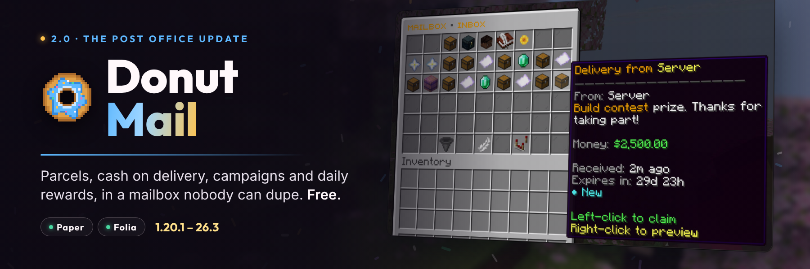

**[Docs](https://nightbeam.dev/docs/donut-mail) · [Discord](https://discord.gg/TJc3CxR4jK) · [Source and issues](https://github.com/MeherBenSalem/donut-mail)**

## Parcels, trades and rewards in one mailbox, made safe

**DonutMail** is a free, open-source mailbox for Paper and Folia, from Minecraft **1.20.1 to 26.3**.

Players open `/mail` and get four tabs: Inbox, Parcels, Sent and Rewards. They send items to any player, online or
offline, with a note, or sell them with **cash on delivery**: the buyer sees the exact items, then pays or declines.
Staff reach every player with one campaign, reward logins with a daily streak calendar and hand out codes, and the
console and other plugins deliver straight into the mailbox.

Every claim, payment, decline and return is one update in storage that exactly one action, on one server, can win. A
claim cut off by a crash is finished or undone the next time the player joins, and nothing is dropped on the ground
unless you allow it.

**2.0 "The Post Office Update"** adds the tabbed mailbox, parcels with notes and postage, cash on delivery, campaigns,
daily rewards, reward codes, live and join notifications, PlaceholderAPI, NuVotifier vote rewards, a Discord webhook,
mailbox blocks, staff tools, an audit log, MySQL networks and a developer API. This release was tested live on Paper
and Folia 1.20.1, 1.21.11 and 26.3, on two servers sharing one database, and as an upgrade from 1.1.0.

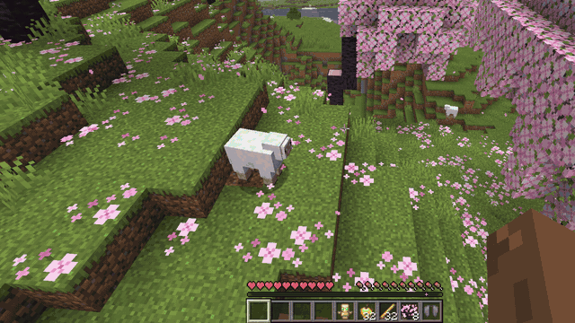

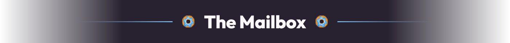

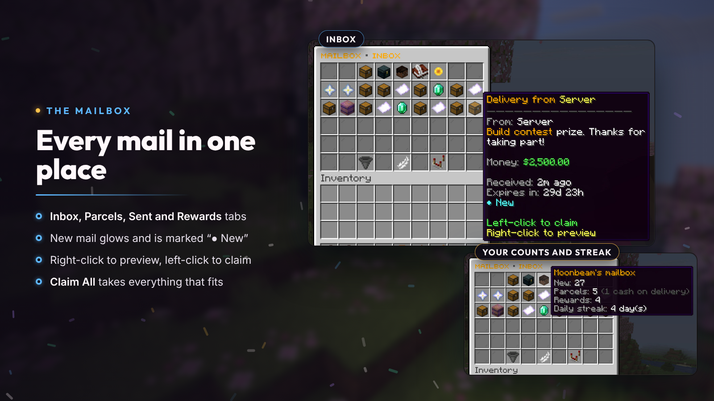

- **Four tabs**: Inbox (messages, deliveries, payments, returns and campaigns), Parcels (items other players sent you,
  cash on delivery at the top), Sent (your parcels and what happened to them) and Rewards (the daily calendar, daily
  rewards, codes and votes).
- New mail glows and is marked **● New** until you open or claim it. Your head at the top shows your counts and
  your daily streak.
- **Left-click** to claim, or **right-click** to look inside before you do.
- **Claim All** takes everything on the tab that fits, and `/mail claimall` does the same from chat.
- **Partial claims**: what fits is handed over and the rest stays in the mailbox. Stacks are never split, and nothing
  is dropped on the ground unless you allow it.

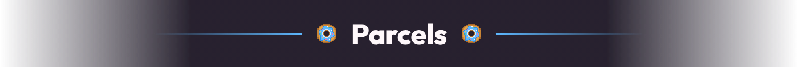

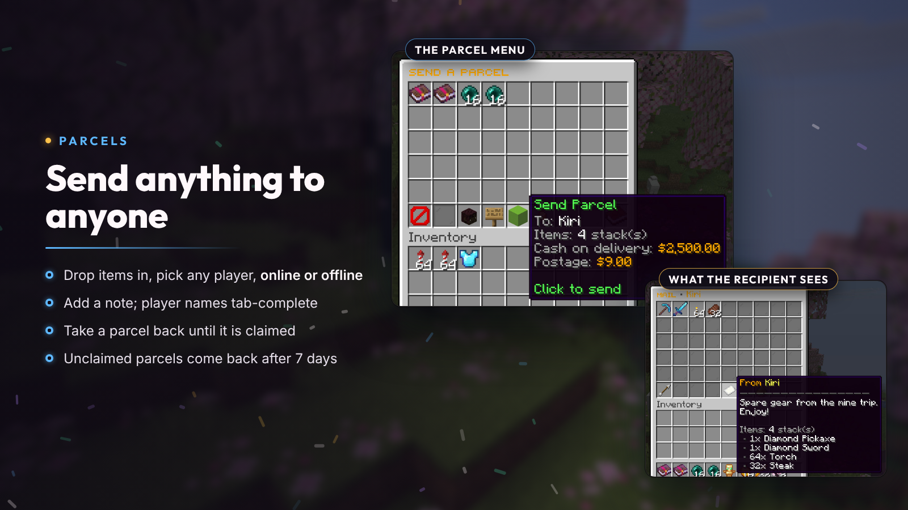

1. `/mail send <player>` (or **Send a Parcel**) opens the parcel menu. Put the items in the top five rows.
2. Pick the recipient: any player, online or offline, and names tab-complete. Add a note of up to 120 characters.
3. Set a cash-on-delivery price if you are selling, then press **Send**. The button shows the recipient, the stacks,
   the price and the postage.

The recipient is told at once, on any server of a network, or with a summary when they join. Follow your parcels on
the **Sent** tab and **take one back** until it is claimed. Parcels nobody claims come back after 7 days, and closing
the menu without sending gives everything back.

Players choose who can send them parcels (`/mail block <player>`, `/mail toggle`). Servers set a 10-second cooldown,
30 parcels a day, 5 parcels from one sender per mailbox, 54 per mailbox, an item blacklist and optional postage (a
flat fee and/or a fee per stack).

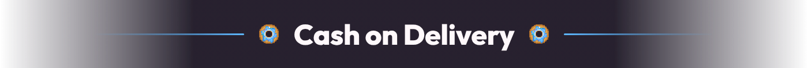

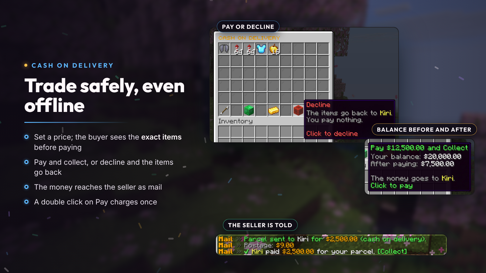

- Sell to a player who is not online: `/mail send Kiri cod 2.5k`, or set the price with the gold nugget in the parcel
  menu. `1k`, `2.5m` and `1,250` work.
- The buyer previews **the exact items**, with their balance before and after, then **pays and collects** or
  **declines**. A declined parcel goes back to the seller and nothing is charged.
- The money reaches the seller as a **payment** in their mailbox, and they are told right away if they are online.
  It waits there until they collect it.
- The parcel is locked for one payment before any money moves, so a double click, a second player or a second server
  finds it locked. A payment and a take-back at the same moment can never both succeed.
- Optional tax (`cash-on-delivery.tax-percent`, 0 by default) and price limits.

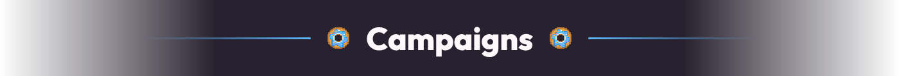

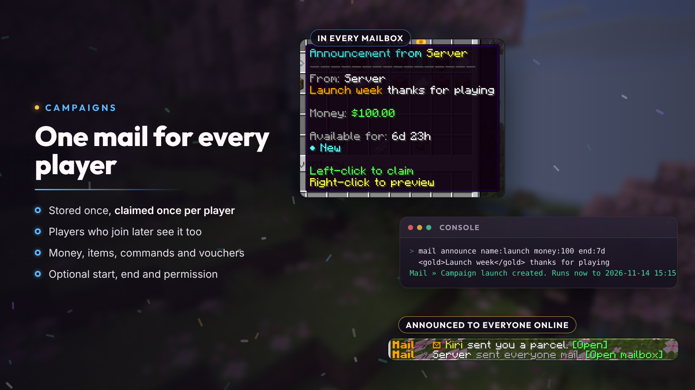

- `/mail announce` sends one mail to **every player**, including players who join later. It is stored once, and each
  player claims it once.
- Money, the item in your hand, vouchers and console commands, with an optional start, end and permission:
  `/mail announce name:launch money:100 end:7d <gold>Launch week</gold> thanks for playing`.
- Online players get a chat line with a link; everyone else finds it in their Inbox. Unclaimed campaigns count as new
  mail.
- `/mail campaign list|end|delete|addcommand` to manage them, and an optional **Discord** post for each new one.
- `/mail give all ...` reaches every known player the same way, stored once instead of one mail each.

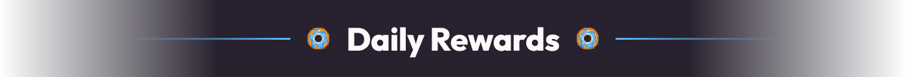

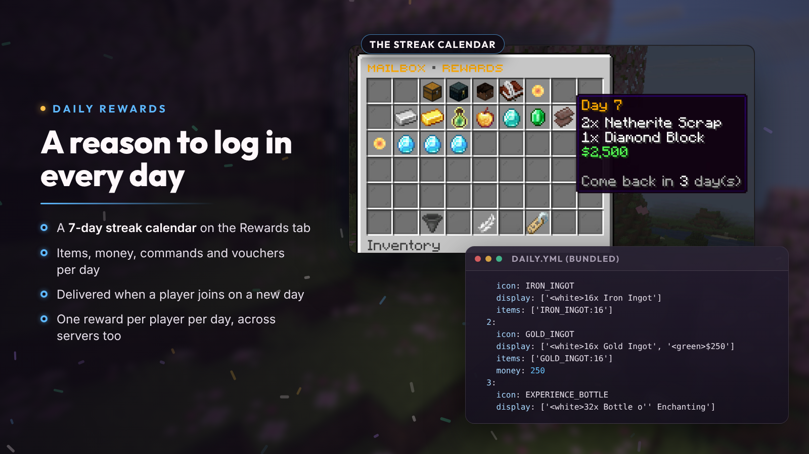

- A streak calendar in `daily.yml`: 7 days by default, each with items, money, console commands and a voucher. Add as
  many days as you like.
- When a player joins on a new day, that day's reward goes to the **Rewards** tab, with a chat line to claim it.
- The calendar shows the days collected, today's reward and what is coming.
- Missing a day starts the streak again (or just pauses it); after the last day it loops or keeps giving the last
  reward.
- One delivery per player per day, also across servers on one database. `/mail admin streak` restores a streak after
  an outage.

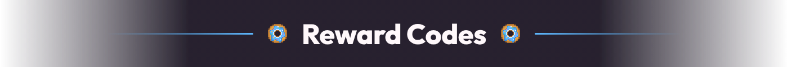

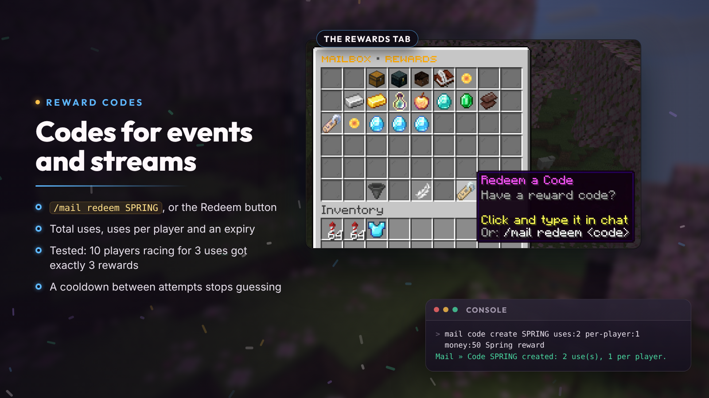

- Players type `/mail redeem <code>` or click **Redeem a Code** on the Rewards tab. The reward arrives in the Rewards
  tab.
- `/mail code create SPRING uses:2 per-player:1 money:50 Spring reward`: total uses, uses per player and an expiry,
  with money, the item in your hand, a voucher or console commands.
- Each redemption counts the use and saves the reward in one transaction. In the tests, 10 players redeeming a code
  with 3 uses at the same moment got exactly 3 rewards.
- A 3-second cooldown between attempts stops guessing. Codes are shared between servers on one database.

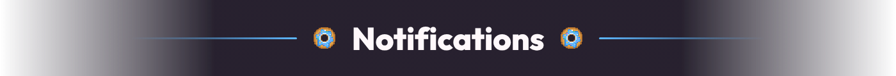

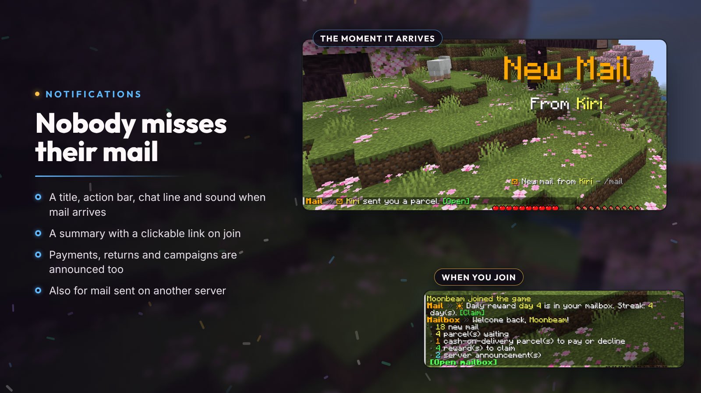

- **Live**: a title, an action bar line, a chat line with an *[Open]* link and a sound the moment mail arrives. Each
  one can be turned off.
- **When you join**: a summary of new mail, parcels, cash-on-delivery parcels to pay, rewards and announcements, with
  a clickable *[Open mailbox]*.
- **Payments and returns**: sellers are told when a buyer pays, and senders when a parcel comes back and why.
- **Across servers**: on one database, players are told on whichever server they are on.

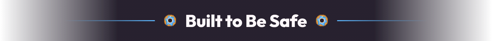

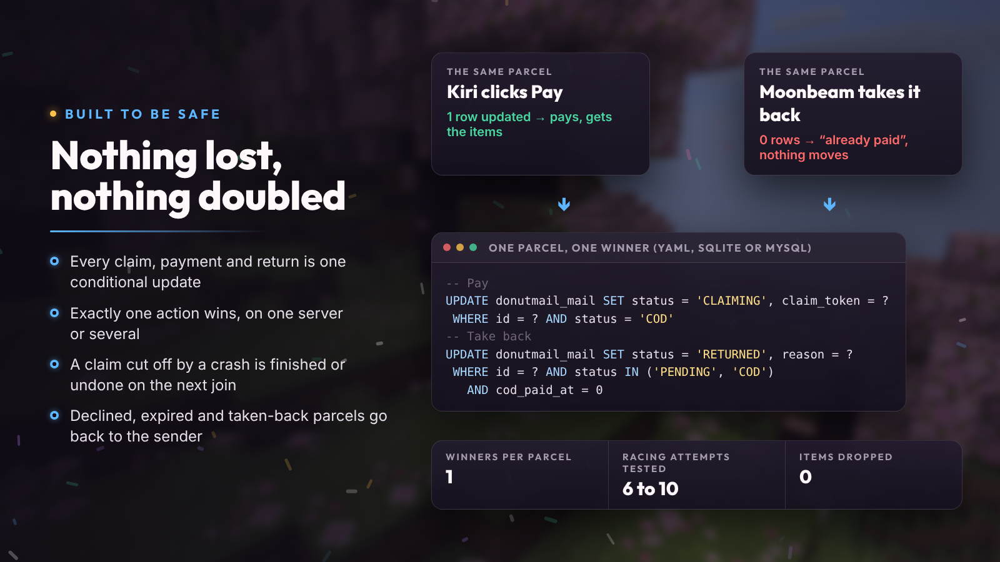

- **One winner per action.** Claiming, paying, declining, taking back, expiry and staff removal are each one
  conditional update in storage. Two clicks, two players or two servers can never both take the same parcel or pay
  for it twice.
- **Tested, not promised.** In the storage tests, 6 to 10 attempts at the same claim, payment, decline, expiry,
  take-back, campaign claim, daily delivery or code redemption start at the same moment, on YAML, SQLite and MariaDB.
  Exactly one wins, every time. In the live tests, a payment and a take-back clicked at the same moment by two players
  had one winner in every round, on one server and across two.
- **Crash-safe claims.** A claim interrupted by a crash is finished or undone the next time the player joins, decided
  by a receipt written into the player's own save data in the same tick as the items.
- **Items are never deleted silently.** Expired, declined, taken-back and staff-removed parcels go back to the sender,
  and items left in the parcel menu go back to the player or their mailbox.
- **Folia-safe**: inventories change on the player's own thread and nowhere else.
- **Upgrade-proof**: items are stored in Paper's versioned format, so mail survives Minecraft updates.
- **Player text stays text**: names and notes can never add colors, click events or fake messages.

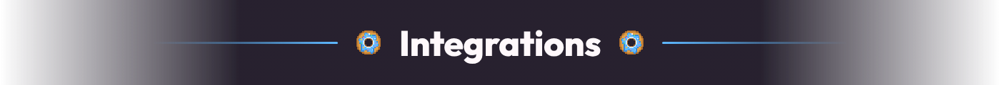

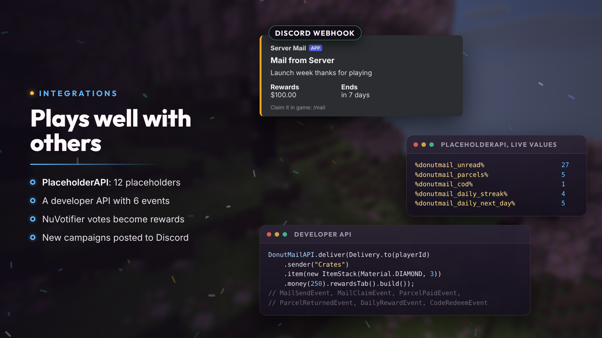

- **PlaceholderAPI**:

| Placeholder | Value |
| --- | --- |
| `%donutmail_unread%`, `%donutmail_waiting%` | New mail, and everything waiting |
| `%donutmail_parcels%`, `%donutmail_cod%` | Parcels waiting, and cash-on-delivery parcels to pay |
| `%donutmail_inbox%`, `%donutmail_rewards%`, `%donutmail_campaigns%` | Mail on the Inbox and Rewards tabs, and campaigns not claimed yet |
| `%donutmail_daily_streak%`, `%donutmail_daily_ready%` | The daily streak, and whether today's reward was delivered |
| `%donutmail_daily_next%`, `%donutmail_daily_next_day%`, `%donutmail_daily_time%` | The next daily reward, its day and the time until it |

- **Developer API**: `DonutMailAPI.deliver(...)` sends items, money, commands and vouchers to the Inbox or the Rewards
  tab, also to offline players and players on other servers: crates, quests, shops, battle passes. `sendParcel(...)`
  sends a parcel on a player's behalf, with cash on delivery, and there are `createCampaign`, `endCampaign`,
  `unread`, `waiting` and `openMailbox`. Events: `MailSendEvent` (cancellable), `MailClaimEvent`, `ParcelPaidEvent`,
  `ParcelReturnedEvent`, `DailyRewardEvent` and `CodeRedeemEvent`.
- **NuVotifier**: every vote becomes a reward on the player's Rewards tab, also when they are offline.
- **Discord webhook**: new campaigns are posted to a channel with the message, the rewards and the end time. Mentions
  such as `@everyone` are never pinged.
- **The console**: `/mail give <player|online|all> <hand|item|voucher|money> [message]`.
- Vault and VaultUnlocked economies, SQLite, MySQL or MariaDB, and YAML for small servers.

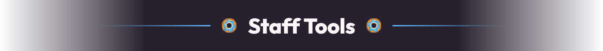

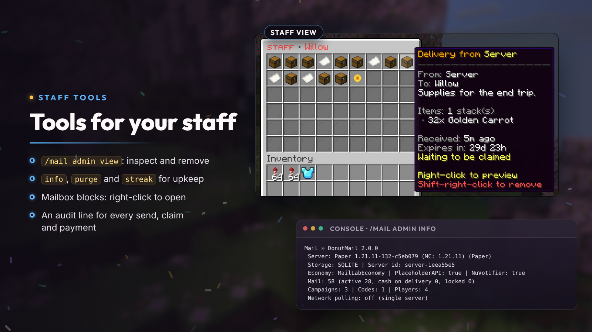

- `/mail admin view <player>`: a player's waiting mail and recent history. Right-click to look inside,
  **shift-right-click** to remove; a player's parcel goes back to its sender.
- `/mail admin info`: version, server, storage, hooks and counts. `/mail admin purge <days>` deletes finished mail,
  and `mail.history-retention-days` (60) does it automatically.
- `/mail admin streak <player> <days>` restores a daily streak after an outage.
- **Mailbox blocks**: look at a block (a lectern, a barrel, a sign) and run `/mail admin setblock`. Right-clicking it
  opens the mailbox.
- An **audit log** in `plugins/DonutMail/logs/` has a line for every send, claim, payment, return, expiry, removal,
  campaign, redemption and daily reward.

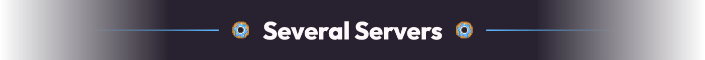

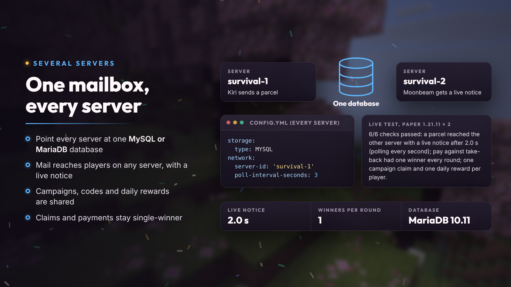

- Set `storage.type: MYSQL` on every server, with the same MySQL or MariaDB database.
- A parcel sent on one server reaches its recipient on another, with a live notice, within
  `network.poll-interval-seconds` (3 by default).
- Campaigns and reward codes are shared, and each player's daily reward is delivered once a day across all servers.
- Claims and payments stay single-winner across servers.
- Tested on two Paper 1.21.11 servers sharing one MariaDB 10.11 database: a parcel reached the other server with a
  live notice after 2.0 seconds (polling every second), and pay against take-back had one winner in every round.

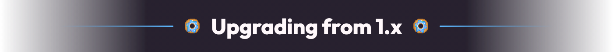

- Replace the jar and restart. Mail stored by 1.x (YAML, SQLite or MySQL) is listed and claimable, and vouchers,
  permissions and settings are kept.
- The texts 1.x kept in `config.yml` move to `messages.yml`, and `messages.yml`, `gui.yml` and `daily.yml` are
  created.
- Tested live: 1.1.0 on Paper 26.3 with YAML storage, an item mail, a text mail and a voucher, then 2.0.0 swapped in
  and all three claimed. The 1.1.0 SQLite and MySQL tables are covered by the unit tests.
- PostMaster data is still migrated, and the `postmaster.*` permissions keep working.

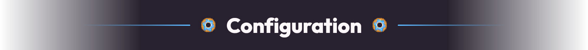

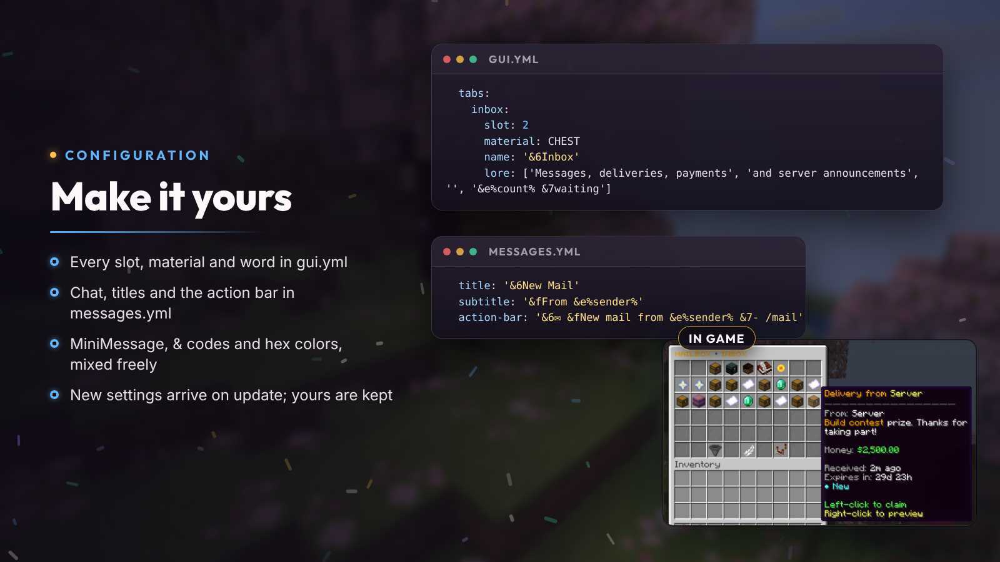

- `config.yml` is fully commented: storage and network, parcel limits, cash on delivery, claims, notifications,
  campaigns, codes, votes, Discord, mailbox blocks, the audit log and sounds. New settings are added automatically
  when you update; your values are kept.
- `gui.yml` has every menu: titles, slots, materials, names, lore and resource-pack models.
- `messages.yml` has every chat line, title and action bar text. Use **MiniMessage**, `&` codes or `&#RRGGBB` hex,
  mixed freely. Player names and notes are always inserted as plain text.
- `daily.yml` holds the calendar, and `vouchers/` holds reward bundles.
- `/mail reload` applies everything without a restart, except storage and network settings.

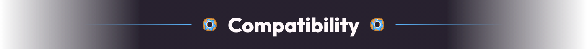

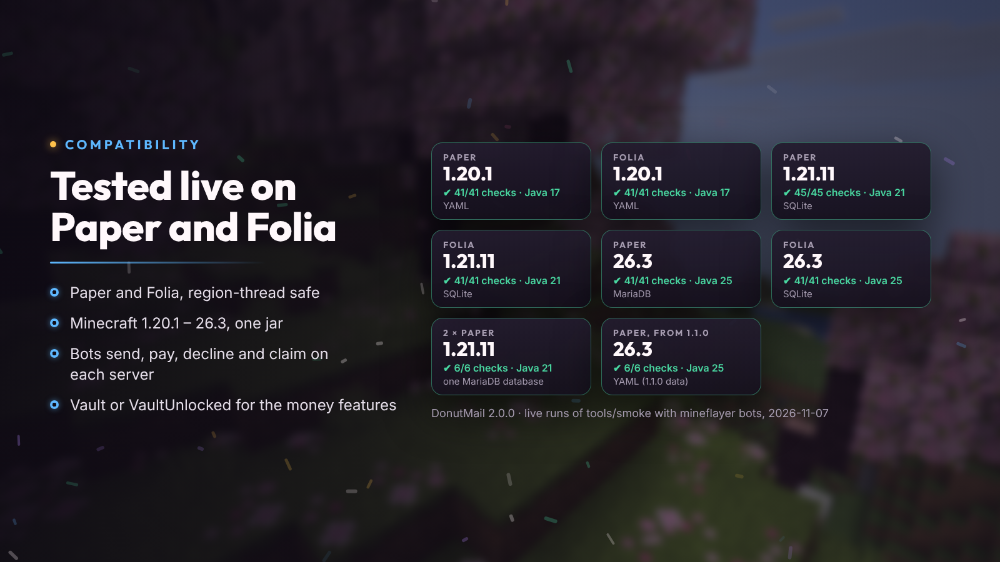

| Server | Minecraft | Java | Notes |
| --- | --- | --- | --- |
| Paper | 1.20.1 – 1.20.4 | 17+ | |
| Paper | 1.20.5 – 1.21.11 | 21+ | |
| Paper | 26.1 – 26.3 | 25+ | |
| Folia | 1.20.1 – 26.3 | as above | Region-thread safe |
| Purpur, other Paper forks | 1.20.1 – 26.3 | as above | The same jar runs on them; they were not part of the 2.0.0 live tests. |
| Spigot, Bukkit | — | — | Not supported: they lack Paper's API. The plugin says so and disables itself. |

- Money features (cash on delivery, postage, money rewards) need **Vault** or **VaultUnlocked** and an economy plugin.
  Everything else works without one.
- Optional: PlaceholderAPI, NuVotifier, and MySQL or MariaDB for several servers.
- One jar for every version. Install it on the server; players need no mods.
- The 2.0.0 live tests ran on Paper 1.20.1, 1.21.11 and 26.3 and Folia 1.20.1, 1.21.11 and 26.3, with bots over the
  network protocol sending, paying, declining and claiming on each: every check passed, with no DonutMail errors.
  Bots on 26.3 used the 26.1 protocol through ViaVersion and ViaBackwards. Versions in between were not part of the
  run.
- A second test runs two servers on one MariaDB database, and a third upgrades 1.1.0 data to 2.0.0.

| Command | What it does | Permission |
| --- | --- | --- |
| `/mail` (`/mailbox`) | Open the mailbox | `donutmail.use` |
| `/mail inbox\|parcels\|sent\|rewards` | Open a tab | `donutmail.use` |
| `/mail send <player>` | Send a parcel to a player, online or offline | `donutmail.senditem` |
| `/mail send <player> cod <price>` | A parcel with cash on delivery | `donutmail.senditem` + `donutmail.cod` |
| `/mail claimall` | Claim everything that fits | `donutmail.use` |
| `/mail redeem <code>` | Redeem a reward code | `donutmail.redeem` |
| `/mail block\|unblock <player>`, `blocklist`, `toggle` | Who can send you parcels | `donutmail.use` |
| `/mail give <player\|online\|all> <hand\|item\|voucher\|money>` | Deliver from staff or the console | `donutmail.admin` |
| `/mail announce [options] <message>` | A campaign for every player | `donutmail.admin` |
| `/mail campaign list\|end\|delete\|addcommand` | Manage campaigns | `donutmail.admin` |
| `/mail code create\|delete\|list\|addcommand` | Reward codes | `donutmail.admin` |
| `/mail admin view\|info\|purge\|streak\|setblock\|removeblock` | Staff tools | `donutmail.admin` |
| `/mail reload` | Reload the configuration | `donutmail.admin` |

| Permission | Default | What it allows |
| --- | --- | --- |
| `donutmail.use` | everyone | The mailbox, claiming, the block list and the refuse toggle |
| `donutmail.senditem` | everyone | Send parcels |
| `donutmail.cod` | everyone | Send cash-on-delivery parcels |
| `donutmail.redeem` | everyone | Redeem reward codes |
| `donutmail.daily` | everyone | Receive daily rewards |
| `donutmail.bypass.limits` | op | Ignore the parcel cooldown, the daily limit and the mailbox limits |
| `donutmail.postage.exempt` | op | Send parcels without postage |
| `donutmail.admin` | op | Every staff command |

`/donutmail` and `/postmaster` are aliases of `/mail`. The 1.x commands and the PostMaster-era `postmaster.*`
permissions keep working.

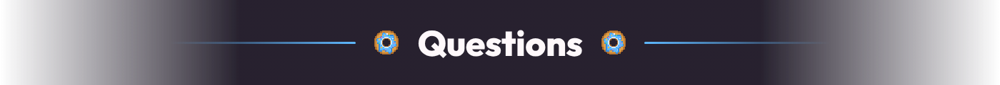

**Is it really free?**
Yes, all of it: parcels, cash on delivery, campaigns, daily rewards, codes, the API and several servers on MySQL. The
source is on GitHub under Apache-2.0.

**I'm updating from 1.x. Will I lose anything?**
No. Replace the jar and restart. Mail stored by 1.x (YAML, SQLite or MySQL), vouchers, permissions and settings are
kept, and the 1.x texts in `config.yml` move to `messages.yml`. Back up `plugins/DonutMail` beforehand, as with any
update.

**Does it work on Spigot?**
No. DonutMail uses Paper's API (Adventure text, region schedulers). Paper is a drop-in replacement for Spigot.

**Can players dupe items with it?**
Every claim, payment, decline, return and expiry is one conditional update that exactly one action can win, also
across servers, and a claim interrupted by a crash is finished or undone from a receipt in the player's own save
data. If you ever find a way, please report it privately (see SECURITY.md on GitHub).

**Can players scam each other with cash on delivery?**
The buyer sees the exact items before paying, and pays for exactly what is in the preview. The seller cannot change a
parcel after sending it; they can take it back while it is unpaid, and a payment and a take-back at the same moment
cannot both succeed.

**What happens to parcels nobody claims?**
They go back to the sender after `parcels.expire-days` (7). Returned parcels and payments never expire.

**Another plugin on my server also has a /mail command. Which one runs?**
If another plugin takes `/mail`, `/mailbox` and `/donutmail` still open DonutMail, and an alias in `commands.yml` can
point `/mail` at it.

**How do I give something to every player, including new ones?**
`/mail announce`. It is stored once and each player claims it once.

**How do I translate it?**
Edit `messages.yml` (chat) and `gui.yml` (menus) and run `/mail reload`. MiniMessage, `&` codes and hex colors all
work.

**Where are the docs?**
On our website: **[Documentation](https://nightbeam.dev/docs/donut-mail)** · [Configuration](https://nightbeam.dev/docs/donut-mail/configuration) · [Commands](https://nightbeam.dev/docs/donut-mail/commands) · [Permissions](https://nightbeam.dev/docs/donut-mail/permissions) · [Placeholders](https://nightbeam.dev/docs/donut-mail/placeholders) · [Developer API](https://nightbeam.dev/docs/donut-mail/developer-api) · [Issues](https://github.com/MeherBenSalem/donut-mail/issues)

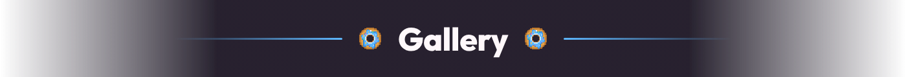

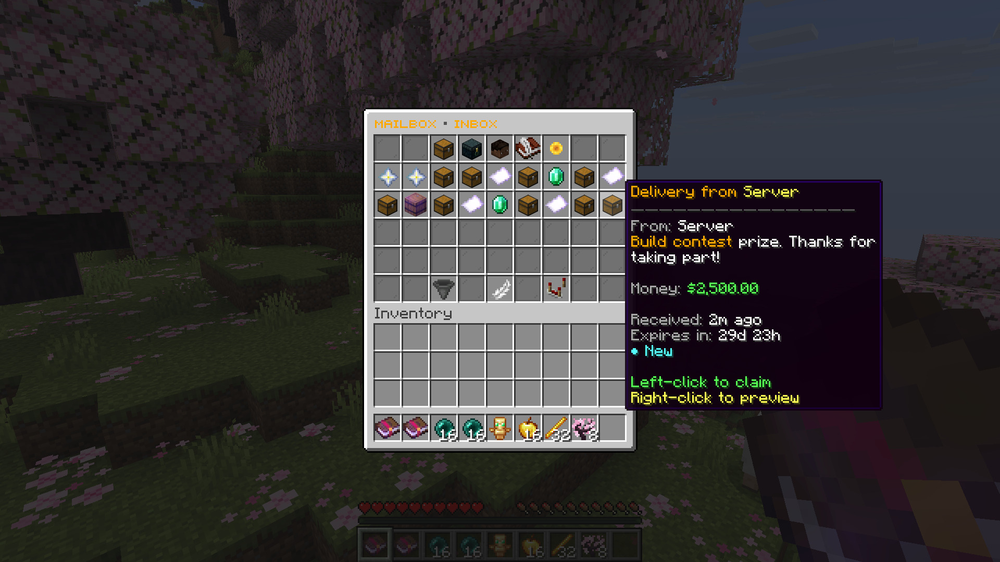

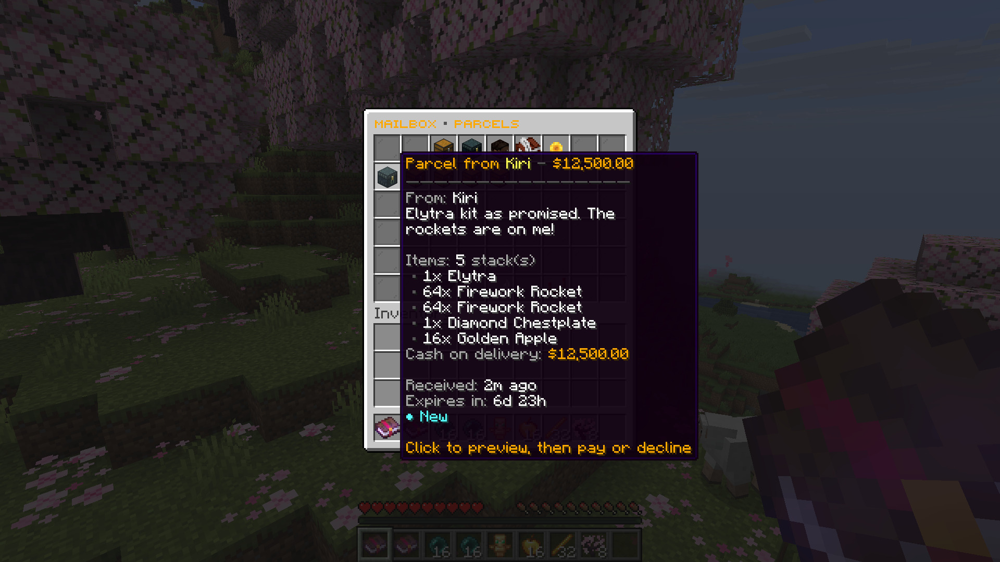

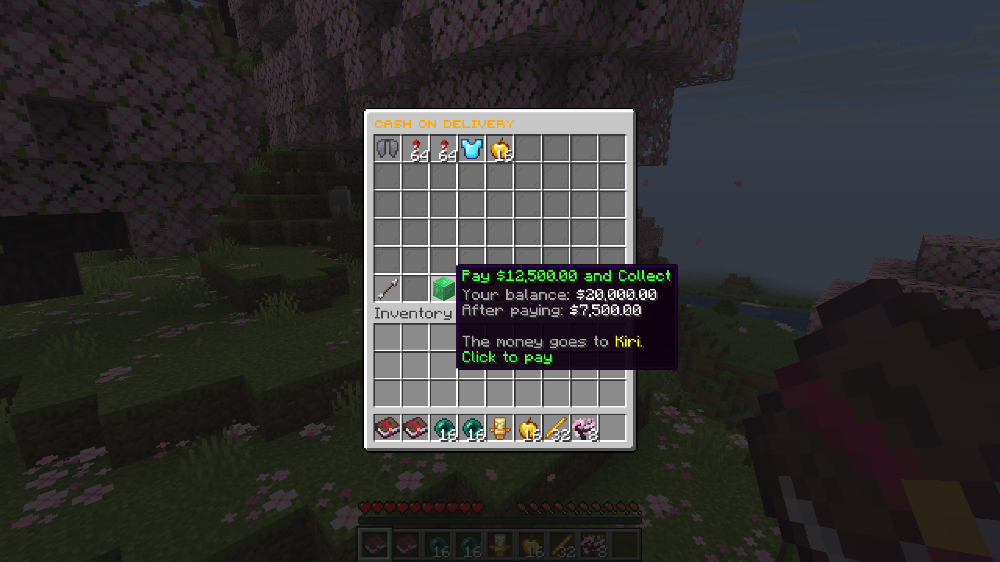

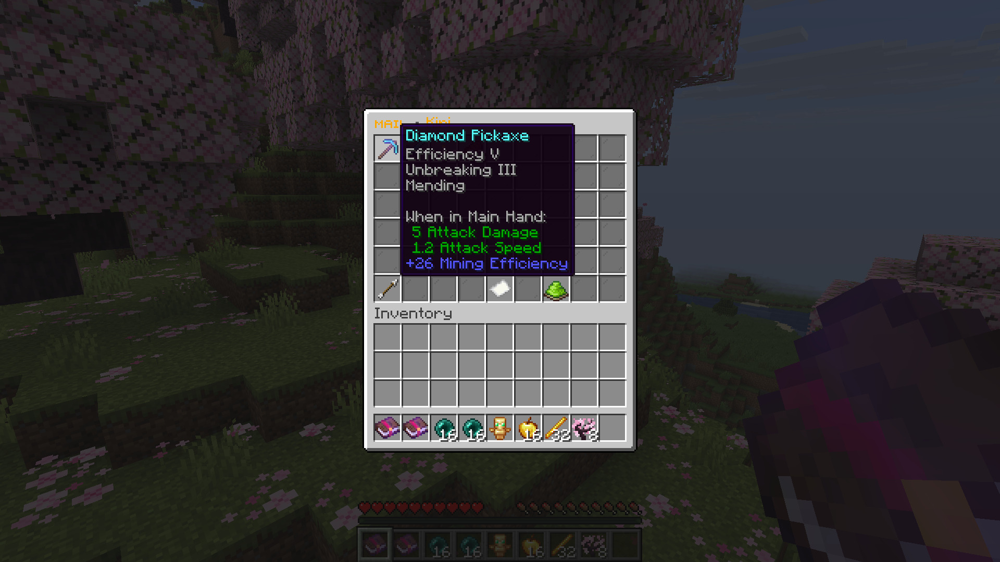

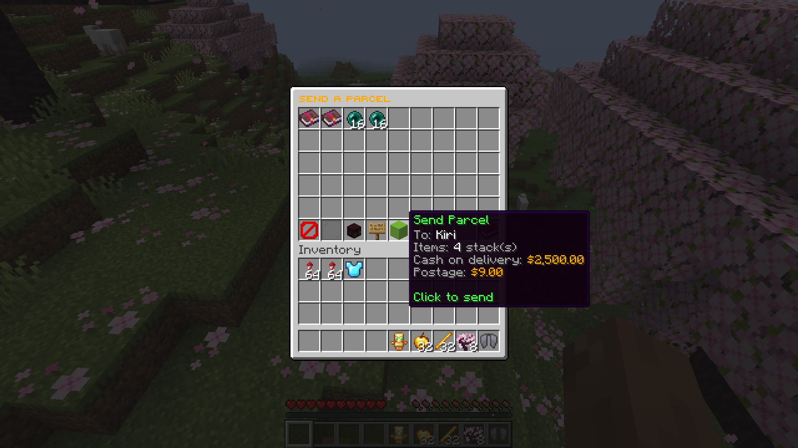

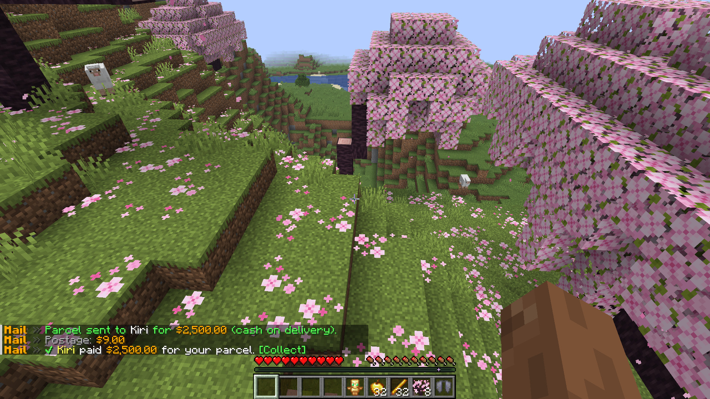

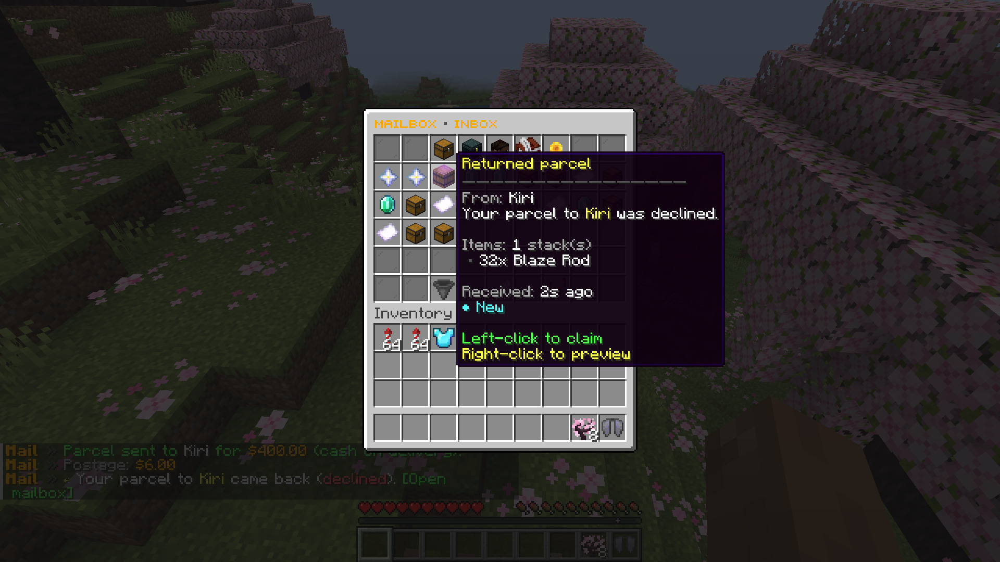

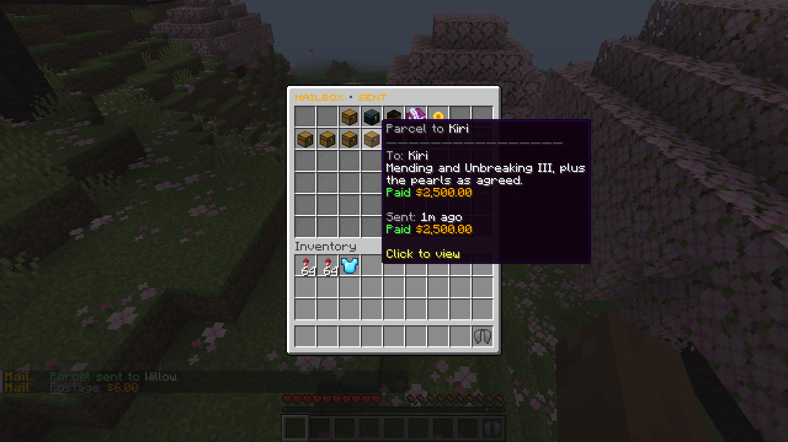

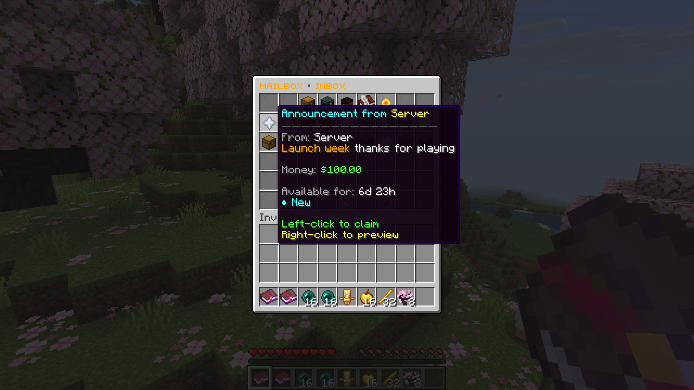

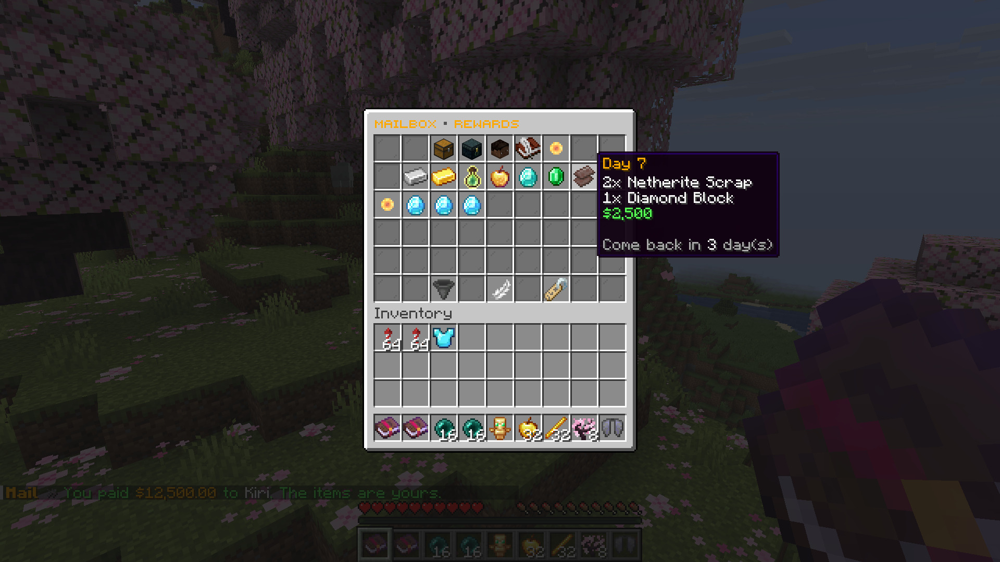

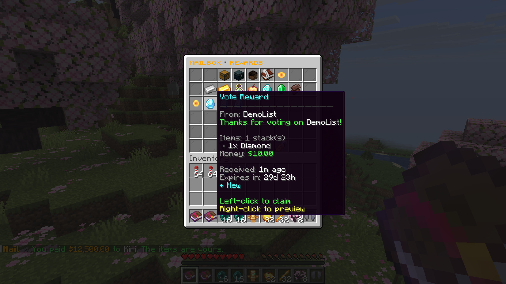

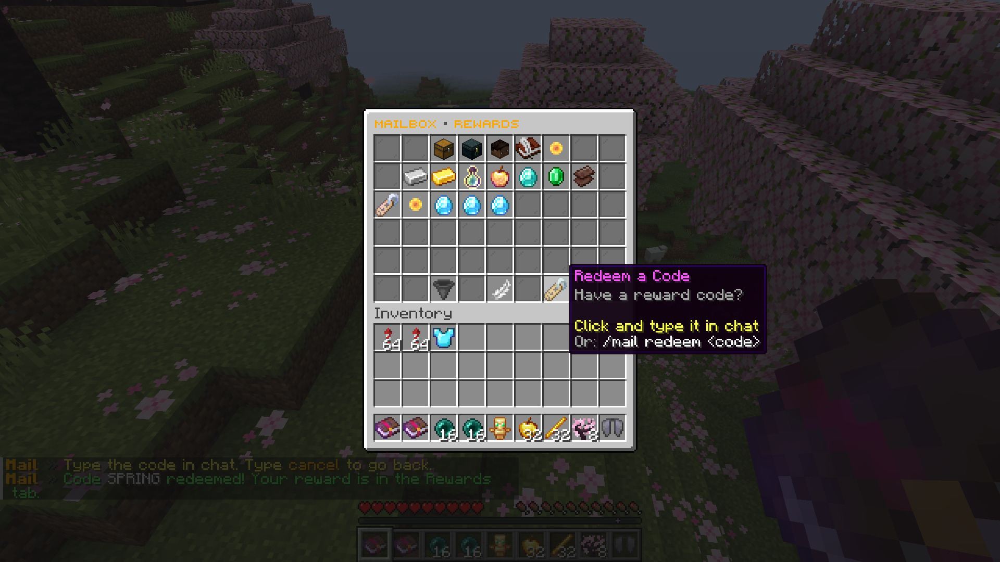

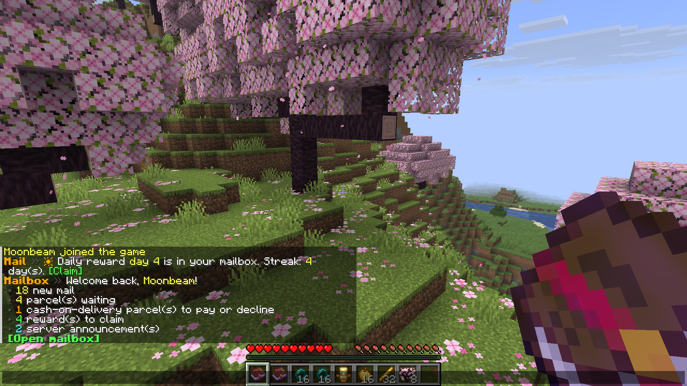

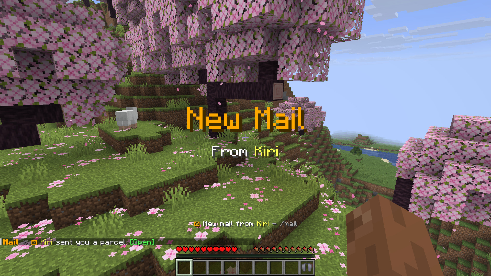

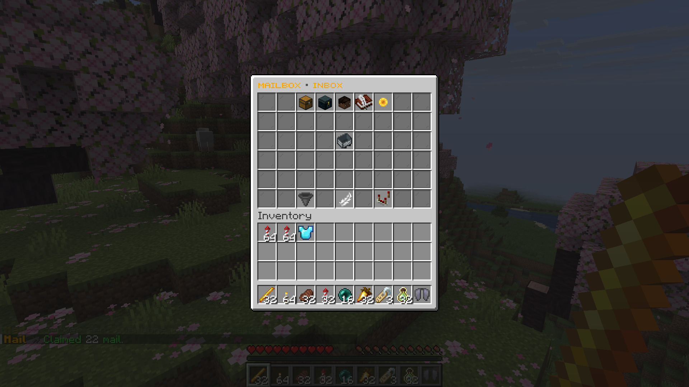

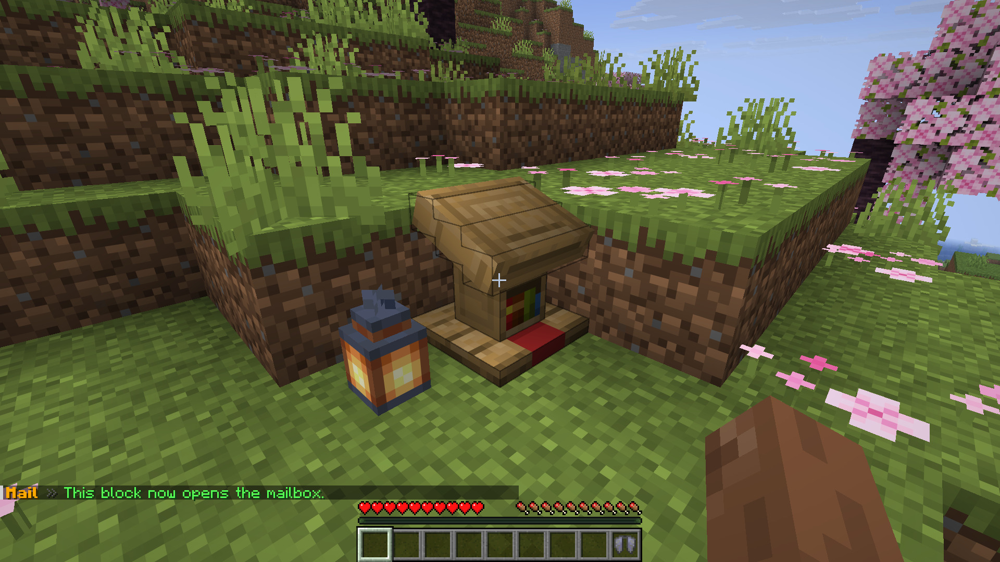

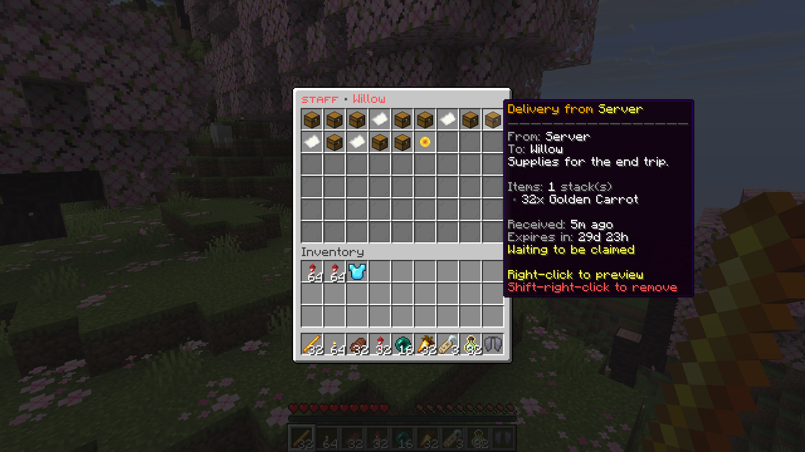

---

DonutMail is licensed under Apache-2.0. The Outfit and Inter fonts used in this artwork are licensed under the SIL
Open Font License 1.1. Screenshots are unedited captures of the vanilla Minecraft client on a Paper server running
the plugin. DonutMail is an independent project and is not affiliated with Mojang, Microsoft or any server it takes
inspiration from.

---

> **Running a server?** NightBeam's premium plugins are on [BuiltByBit](https://nightbeam.dev/store): NightWatch Pro anti-cheat, the AstralSMP setup, Astral Core and more.

---

### More from NightBeam Studio

- **[Remnants: Ashen Legacy](https://www.curseforge.com/minecraft/modpacks/remnants-ashen-legacy)**: the story-driven soulslike RPG modpack built on NightBeam's mods
- **[Premium server plugins](https://nightbeam.dev/store)**: anti-cheat, ranked PvP, SMP setups and more on BuiltByBit
- **[NightBeam Pro](https://nightbeam.dev/memberships)**: the model library and NightBeam Forge credits, from $5 a month
- **[Discord](https://discord.gg/TJc3CxR4jK)**: support, bug reports, suggestions and early looks
- **[Support NightBeam](https://nightbeam.dev/support)**: help keep every mod free

**Follow:** [YouTube](https://www.youtube.com/@nightbeamstudio) · [Instagram](https://www.instagram.com/nightbeamstudio/) · [X](https://x.com/NightBeamLLC) · [Facebook](https://www.facebook.com/profile.php?id=61574823331471)
